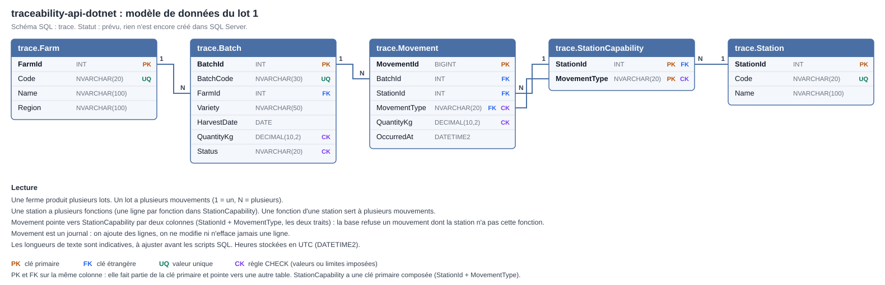

# Modèle de données

Ce document décrit le modèle de données du projet. L'avancement est dans le [README](../README.md) ; les preuves observées sont dans [verification.md](verification.md).

Le contexte métier est dans [fonctionnel.md](fonctionnel.md).

## 1. Schéma

Ce schéma est celui du lot 1 : il ne montre ni les colonnes d'auteur (lot 11) ni la table `MovementCorrection` (lot 12a), décrites plus bas.

Lecture :

- Une ferme produit plusieurs lots (`Farm` 1 → N `Batch`).
- Un lot a plusieurs mouvements (`Batch` 1 → N `Movement`).
- Une station a plusieurs fonctions (`Station` 1 → N `StationCapability`).
- Une fonction d'une station sert à plusieurs mouvements (`StationCapability` 1 → N `Movement`).
- Un mouvement peut avoir plusieurs corrections (`Movement` 1 → N `MovementCorrection`) ; une correction vise un seul mouvement.

Toutes les tables sont dans le schéma SQL `trace`.

## 2. Les tables

Toutes les colonnes sont `NOT NULL` (validé). Légende : PK clé primaire, FK clé étrangère, UQ valeur unique, CK règle CHECK.

### 2.1 `trace.Farm` : les fermes

| Colonne | Type | Contrainte | Rôle |
|---|---|---|---|
| `FarmId` | `INT` | PK, `IDENTITY` | Numéro technique, généré par SQL Server. |
| `Code` | `NVARCHAR(20)` | UQ, CK non vide | Code lisible de la ferme (par exemple `F01`). |
| `Name` | `NVARCHAR(100)` | | Nom de la ferme. |
| `Region` | `NVARCHAR(100)` | | Région de la ferme. |

### 2.2 `trace.Batch` : les lots (la photo)

Une ligne par lot. Elle donne l'état actuel : statut et dernière quantité connue.

| Colonne | Type | Contrainte | Rôle |
|---|---|---|---|
| `BatchId` | `INT` | PK, `IDENTITY` | Numéro technique, utilisé pour les liens entre tables. |
| `BatchCode` | `NVARCHAR(30)` | UQ, CK non vide | Code lisible du lot (par exemple `LOT-2026-0001`). |
| `FarmId` | `INT` | FK → `Farm.FarmId` | Ferme d'origine. |
| `Variety` | `NVARCHAR(50)` | | Variété de tomate. |
| `HarvestDate` | `DATE` | | Date de récolte. |
| `QuantityKg` | `DECIMAL(10,2)` | CK > 0 | Dernière quantité connue, en kg. |
| `Status` | `NVARCHAR(20)` | CK | `RECEIVED`, `SORTED`, `PACKED` ou `SHIPPED`. |

### 2.3 `trace.Station` : les stations

| Colonne | Type | Contrainte | Rôle |
|---|---|---|---|
| `StationId` | `INT` | PK, `IDENTITY` | Numéro technique. |
| `Code` | `NVARCHAR(20)` | UQ, CK non vide | Code lisible de la station (par exemple `SITE-01`). |
| `Name` | `NVARCHAR(100)` | | Nom de la station. |

### 2.4 `trace.StationCapability` : les fonctions d'une station

Une ligne par fonction. Une station avec deux fonctions a deux lignes.

| Colonne | Type | Contrainte | Rôle |
|---|---|---|---|
| `StationId` | `INT` | PK, FK → `Station.StationId` | La station. |
| `MovementType` | `NVARCHAR(20)` | PK, CK | La fonction : `RECEPTION`, `SORTING`, `PACKING` ou `SHIPMENT`. |

La clé primaire est composée des deux colonnes : la même fonction ne peut pas être déclarée deux fois pour une station.

### 2.5 `trace.Movement` : les mouvements (le film)

Le journal. On ajoute des lignes, on ne modifie ni n'efface jamais une ligne.

| Colonne | Type | Contrainte | Rôle |
|---|---|---|---|
| `MovementId` | `BIGINT` | PK, `IDENTITY` | Numéro technique. |
| `BatchId` | `INT` | FK → `Batch.BatchId` | Le lot concerné. |
| `StationId` | `INT` | FK → `StationCapability` (avec `MovementType`) | La station où se passe le mouvement. |
| `MovementType` | `NVARCHAR(20)` | FK → `StationCapability` (avec `StationId`), CK | `RECEPTION`, `SORTING`, `PACKING` ou `SHIPMENT`. |
| `QuantityKg` | `DECIMAL(10,2)` | CK > 0 | Quantité constatée à cette étape, en kg. |
| `OccurredAt` | `DATETIME2` | | Date et heure du mouvement, en UTC. |
| `AuthorId` | `NVARCHAR(64)` | CK non vide | Identifiant stable du compte qui a saisi le mouvement (champ `sub` du jeton). |
| `AuthorName` | `NVARCHAR(100)` | CK non vide | Nom d'utilisateur au moment de la saisie (champ `preferred_username` du jeton). |

`StationId` et `MovementType` forment ensemble une clé étrangère sur deux colonnes vers la clé primaire de `StationCapability`. La base accepte donc un mouvement seulement si la station a cette fonction.

`AuthorId` et `AuthorName` disent qui a saisi le mouvement (lot 11). Ils sont obligatoires, sans valeur par défaut, et chacun a une contrainte `CHECK` : ni vide, ni espaces seulement (`CK_Movement_AuthorId_NotEmpty` et `CK_Movement_AuthorName_NotEmpty`). L'API les lit dans le jeton déjà validé. `AuthorId` ne change pas si la personne change de nom ; `AuthorName` est le nom au moment de la saisie, il ne suit pas un changement de nom ultérieur. L'API renvoie seulement le nom : l'identifiant ne sort pas de la base. Les mouvements d'avant le lot 11 portent une valeur de remplacement, `AuthorId` = `00000000-0000-0000-0000-000000000000` et `AuthorName` = `Initial_User`, posée par `database/018_add_movement_author.sql`.

Un index non unique, `IX_Movement_BatchId` (sur `BatchId`), sert à retrouver les mouvements d'un lot. Il est créé par `database/010_create_indexes.sql`, pas par `002`. Un second index non unique, `IX_Batch_FarmId` (sur `Batch (FarmId)`), sert à compter les lots d'une ferme, ou tous les lots, sans lire toute la table (total de `ListBatches`) ; il est créé par `database/017_optimize_list_batches.sql`.

### 2.6 `trace.MovementCorrection` : les corrections des mouvements

Une ligne par correction (lot 12a, [ADR 0016](adr/0016-correction-des-mouvements.md)). On ajoute des lignes, on ne modifie ni n'efface jamais une ligne. Le mouvement corrigé reste tel qu'il a été saisi dans `Movement`.

| Colonne | Type | Contrainte | Rôle |
|---|---|---|---|
| `CorrectionId` | `BIGINT` | PK, `IDENTITY` | Numéro technique. Pour un mouvement, la plus grande valeur est sa dernière correction. |
| `MovementId` | `BIGINT` | FK → `Movement.MovementId` | Le mouvement corrigé. |
| `Kind` | `NVARCHAR(10)` | CK | `REPLACE` (nouvelles valeurs) ou `CANCEL` (le mouvement n'a pas eu lieu). |
| `StationId` | `INT` | FK → `StationCapability` (avec `MovementType`) | La station de la version corrigée. |
| `MovementType` | `NVARCHAR(20)` | FK → `StationCapability` (avec `StationId`), CK | Le type du mouvement, qui ne change pas. |
| `QuantityKg` | `DECIMAL(10,2)` | CK > 0 | La quantité de la version corrigée, en kg. Pour `CANCEL`, la ligne répète celle de la version annulée. |
| `OccurredAt` | `DATETIME2` | | La date et l'heure de la version corrigée, en UTC. |
| `ReasonCode` | `NVARCHAR(20)` | CK | `DATA_ENTRY_ERROR`, `MEASUREMENT_ERROR` ou `OTHER`. |
| `ReasonComment` | `NVARCHAR(500)` | CK | Le commentaire. Il ne peut pas être vide pour `OTHER`. |
| `AuthorId` | `NVARCHAR(64)` | CK non vide | Identifiant du compte qui a corrigé (champ `sub` du jeton). |
| `AuthorName` | `NVARCHAR(100)` | CK non vide | Nom d'utilisateur au moment de la correction. |
| `CorrectedAt` | `DATETIME2` | `DEFAULT SYSUTCDATETIME()` | Date et heure de la correction, en UTC, mises par la base. |

La version valable d'un mouvement est sa ligne de `Movement` avec sa dernière correction appliquée ; une annulation est définitive. Un index non unique, `IX_MovementCorrection_MovementId` (sur `MovementId`), retrouve les corrections d'un mouvement ; il est créé avec la table et n'a pas été mesuré (la table commence vide). La table est créée par `002` pour une base neuve et par `database/019_add_movement_correction.sql` pour une base existante.

## 3. Choix de conception

- **Deux identifiants par objet** : un numéro technique (`IDENTITY`) pour les liens entre tables, un code lisible unique pour les humains et l'API. Un code métier peut changer de format, un numéro technique ne change pas.
- **`BIGINT` pour `MovementId`** : le journal est la table qui grossit le plus. Les autres tables utilisent `INT`.
- **Clé étrangère sur deux colonnes pour la fonction de la station** : la règle « la station doit avoir la fonction » est garantie par la base elle-même, pas seulement par la procédure. Elle empêche aussi de supprimer une fonction déjà utilisée par des mouvements, ce qui protège l'historique.
- **Statuts et types en `CHECK`** : la base refuse toute valeur hors liste.
- **Codes non vides** : un `CHECK` (`LEN(TRIM(code)) > 0`) refuse un code vide ou fait seulement d'espaces. Il ne s'applique qu'aux trois codes : `Name`, `Region` et `Variety` peuvent encore être vides (choix du 2026-10-18, à revoir si besoin).
- **Classement `French_CI_AS`** (celui de l'instance, insensible à la casse) : `F01` et `f01` sont traités comme le même code. Vérifié par un test, voir [verification.md](verification.md).
- **`DECIMAL(10,2)` pour les quantités** : décimal exact, sans erreur d'arrondi (contrairement à `FLOAT`). Supérieur à 0.
- **`DATETIME2` en UTC** : plus précis et plus étendu que `DATETIME`. L'UTC évite les ambiguïtés de fuseau et de changement d'heure.
- **Schéma `trace`** : regroupe les objets du projet, séparés du schéma par défaut `dbo`.
- **Les corrections dans une table à part** (lot 12a) : le journal `Movement` reste un journal où l'on n'ajoute que des lignes. La table reprend les mêmes clés étrangères sur deux colonnes (station et fonction) que `Movement` : une version corrigée ne peut pas viser une station qui n'a pas la fonction.
- **Deux index supplémentaires, ajoutés après mesure** : les clés primaires et les contraintes d'unicité créent déjà des index, et une clé étrangère ne crée pas d'index toute seule. Au lot 2b, sur 1 000 000 de lots inventés, `IX_Movement_BatchId` (sur `Movement (BatchId)`) a été ajouté : le parcours d'un lot passe de 25 412 à 15 lectures logiques. Deux autres index ont été essayés puis abandonnés au même lot, `Batch (Status)` et `Batch (FarmId)`, parce que SQL Server ne s'en servait pas ou qu'ils faisaient pire (voir [mesures.md](mesures.md)). Index simple plutôt que couvrant : voir l'[ADR 0004](adr/0004-index-simple-sur-mouvement-par-lot.md). Au lot 5, `IX_Batch_FarmId` (sur `Batch (FarmId)`, 13,57 Mo) a été ajouté : SQL Server ne l'utilise que si le plan du total est refait à chaque appel (`OPTION (RECOMPILE)`) ; le total d'une ferme de 25 000 lots passe alors de 10 574 à 47 lectures logiques, pour environ 0,12 ms de plus par lot créé (voir l'[ADR 0008](adr/0008-listbatches-page-avant-jointure-total-recompile.md)).

## 4. Ce que garantit la base, ce que garantira la procédure

La base garantit seule (clés, unicité, CHECK) :

- Un lot a une ferme existante. Un mouvement a un lot et une station existants.
- Les codes sont uniques.
- Les codes ne sont ni vides ni faits seulement d'espaces.
- Un mouvement n'est accepté que si la station a la fonction correspondante (clé étrangère sur deux colonnes vers `StationCapability`).
- Les statuts et les types de mouvement sont dans la liste.
- Les quantités sont supérieures à 0.
- Une correction vise un mouvement existant, avec une station qui a la fonction du mouvement ; son genre et son motif sont dans la liste ; un commentaire est présent pour le motif `OTHER` ; l'auteur n'est ni vide, ni fait d'espaces.

Les procédures stockées garantiront (voir les règles dans [fonctionnel.md](fonctionnel.md)) :

- L'ordre des statuts : pas d'étape sautée.
- La quantité qui ne monte pas d'une étape à l'autre.
- Pas de nouveau mouvement pour un lot `SHIPPED`.
- Un mouvement et la mise à jour du lot (statut, quantité) dans la même transaction.
- La création d'un lot avec son premier mouvement `RECEPTION`.
- Les règles des corrections (`ReplaceMovement`, `CancelMovement`) : quantité entre les étapes voisines, dernier mouvement seulement pour l'annulation, jamais la réception, annulation définitive, valeurs identiques refusées ; et la mise à jour du statut et de la quantité du lot.

Le journal `Movement` n'est jamais modifié : les procédures n'ont pas de `UPDATE` ni de `DELETE` dessus (les corrections vont dans `MovementCorrection`). Les droits d'accès à la table seront restreints plus tard.

## 5. Limites connues

- Les longueurs de texte sont indicatives (voir les scripts).
- Les formats de codes (`LOT-2026-0001`, `F01`, `SITE-01`) restent des exemples : la base n'impose que « unique » et « non vide », pas de format.
- `Name`, `Region` et `Variety` acceptent une chaîne vide.
- Le classement est insensible à la casse : `F01` et `f01` ne peuvent pas coexister.
- Pas de découpe ni de fusion de lots.
- Pas de gestion des retours de marchandise : les règles réelles du métier ne sont pas connues (voir [fonctionnel.md](fonctionnel.md), section 9).
- Les procédures de correction ne vérifient pas que l'auteur est un vrai compte, ni l'heure d'une version corrigée (comme pour la saisie).
- Pas de table d'utilisateurs : l'auteur d'un mouvement est enregistré (identifiant et nom pris dans le jeton), mais la base ne connaît pas les comptes et ne vérifie pas qu'un auteur existe.
- Les index sont mesurés sur des données inventées et une seule machine. Le coût en écriture n'est mesuré que pour `IX_Batch_FarmId` (environ 0,12 ms par lot créé, dans SSMS, au lot 5) ; pour `IX_Movement_BatchId`, il ne l'est pas (voir [mesures.md](mesures.md), sections 5 et 9.4).
