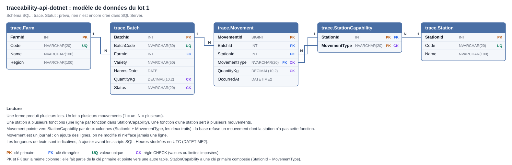

# Modèle de données

Statut : **Prévu**. Rien n'est encore créé dans SQL Server. Ce document décrit le modèle proposé pour le lot 1. Il passera à « Prouvé » après les scripts exécutés et les tests observés.

Le contexte métier est dans [fonctionnel.md](fonctionnel.md).

## 1. Schéma

Lecture :

- Une ferme produit plusieurs lots (`Farm` 1 → N `Batch`).
- Un lot a plusieurs mouvements (`Batch` 1 → N `Movement`).
- Une station a plusieurs fonctions (`Station` 1 → N `StationCapability`).
- Une fonction d'une station sert à plusieurs mouvements (`StationCapability` 1 → N `Movement`).

Toutes les tables sont dans le schéma SQL `trace`.

## 2. Les tables

Toutes les colonnes sont `NOT NULL` (validé). Légende : PK clé primaire, FK clé étrangère, UQ valeur unique, CK règle CHECK.

### 2.1 `trace.Farm` : les fermes

| Colonne | Type | Contrainte | Rôle |
|---|---|---|---|
| `FarmId` | `INT` | PK, `IDENTITY` | Numéro technique, généré par SQL Server. |
| `Code` | `NVARCHAR(20)` | UQ | Code lisible de la ferme (par exemple `F01`). |
| `Name` | `NVARCHAR(100)` | | Nom de la ferme. |
| `Region` | `NVARCHAR(100)` | | Région de la ferme. |

### 2.2 `trace.Batch` : les lots (la photo)

Une ligne par lot. Elle donne l'état actuel : statut et dernière quantité connue.

| Colonne | Type | Contrainte | Rôle |
|---|---|---|---|
| `BatchId` | `INT` | PK, `IDENTITY` | Numéro technique, utilisé pour les liens entre tables. |
| `BatchCode` | `NVARCHAR(30)` | UQ | Code lisible du lot (par exemple `LOT-2026-0001`). |
| `FarmId` | `INT` | FK → `Farm.FarmId` | Ferme d'origine. |
| `Variety` | `NVARCHAR(50)` | | Variété de tomate. |
| `HarvestDate` | `DATE` | | Date de récolte. |
| `QuantityKg` | `DECIMAL(10,2)` | CK > 0 | Dernière quantité connue, en kg. |
| `Status` | `NVARCHAR(20)` | CK | `RECEIVED`, `SORTED`, `PACKED` ou `SHIPPED`. |

### 2.3 `trace.Station` : les stations

| Colonne | Type | Contrainte | Rôle |
|---|---|---|---|
| `StationId` | `INT` | PK, `IDENTITY` | Numéro technique. |
| `Code` | `NVARCHAR(20)` | UQ | Code lisible de la station (par exemple `SITE-01`). |
| `Name` | `NVARCHAR(100)` | | Nom de la station. |

### 2.4 `trace.StationCapability` : les fonctions d'une station

Une ligne par fonction. Une station avec deux fonctions a deux lignes.

| Colonne | Type | Contrainte | Rôle |
|---|---|---|---|
| `StationId` | `INT` | PK, FK → `Station.StationId` | La station. |
| `MovementType` | `NVARCHAR(20)` | PK, CK | La fonction : `RECEPTION`, `SORTING`, `PACKING` ou `SHIPMENT`. |

La clé primaire est composée des deux colonnes : la même fonction ne peut pas être déclarée deux fois pour une station.

### 2.5 `trace.Movement` : les mouvements (le film)

Le journal. On ajoute des lignes, on ne modifie ni n'efface jamais une ligne.

| Colonne | Type | Contrainte | Rôle |
|---|---|---|---|
| `MovementId` | `BIGINT` | PK, `IDENTITY` | Numéro technique. |
| `BatchId` | `INT` | FK → `Batch.BatchId` | Le lot concerné. |
| `StationId` | `INT` | FK → `StationCapability` (avec `MovementType`) | La station où se passe le mouvement. |
| `MovementType` | `NVARCHAR(20)` | FK → `StationCapability` (avec `StationId`), CK | `RECEPTION`, `SORTING`, `PACKING` ou `SHIPMENT`. |
| `QuantityKg` | `DECIMAL(10,2)` | CK > 0 | Quantité constatée à cette étape, en kg. |
| `OccurredAt` | `DATETIME2` | | Date et heure du mouvement, en UTC. |

`StationId` et `MovementType` forment ensemble une clé étrangère sur deux colonnes vers la clé primaire de `StationCapability`. La base accepte donc un mouvement seulement si la station a cette fonction.

## 3. Choix de conception

- **Deux identifiants par objet** : un numéro technique (`IDENTITY`) pour les liens entre tables, un code lisible unique pour les humains et l'API. Un code métier peut changer de format, un numéro technique ne change pas.
- **`BIGINT` pour `MovementId`** : le journal est la table qui grossit le plus. Les autres tables utilisent `INT`.
- **Clé étrangère sur deux colonnes pour la fonction de la station** : la règle « la station doit avoir la fonction » est garantie par la base elle-même, pas seulement par la procédure. Elle empêche aussi de supprimer une fonction déjà utilisée par des mouvements, ce qui protège l'historique.
- **Statuts et types en `CHECK`** : la base refuse toute valeur hors liste.
- **`DECIMAL(10,2)` pour les quantités** : décimal exact, sans erreur d'arrondi (contrairement à `FLOAT`). Supérieur à 0.
- **`DATETIME2` en UTC** : plus précis et plus étendu que `DATETIME`. L'UTC évite les ambiguïtés de fuseau et de changement d'heure.
- **Schéma `trace`** : regroupe les objets du projet, séparés du schéma par défaut `dbo`.
- **Pas d'index supplémentaires au départ** : les clés primaires et les contraintes d'unicité créent déjà des index. Les autres index viendront au lot 2, après mesure avec les plans d'exécution. Une clé étrangère ne crée pas d'index toute seule.

## 4. Ce que garantit la base, ce que garantira la procédure

La base garantit seule (clés, unicité, CHECK) :

- Un lot a une ferme existante. Un mouvement a un lot et une station existants.
- Les codes sont uniques.
- Un mouvement n'est accepté que si la station a la fonction correspondante (clé étrangère sur deux colonnes vers `StationCapability`).
- Les statuts et les types de mouvement sont dans la liste.
- Les quantités sont supérieures à 0.

Les procédures stockées garantiront (voir les règles dans [fonctionnel.md](fonctionnel.md)) :

- L'ordre des statuts : pas d'étape sautée.
- La quantité qui ne monte pas d'une étape à l'autre.
- Pas de nouveau mouvement pour un lot `SHIPPED`.
- Un mouvement et la mise à jour du lot (statut, quantité) dans la même transaction.
- La création d'un lot avec son premier mouvement `RECEPTION`.

Le journal `Movement` n'est jamais modifié : les procédures n'ont pas de `UPDATE` ni de `DELETE` dessus. Les droits d'accès à la table seront restreints plus tard.

## 5. Limites connues

- Les longueurs de texte sont indicatives.
- Les formats de codes (`LOT-2026-0001`, `F01`, `SITE-01`) sont des exemples, à fixer avant les scripts.
- Pas de découpe ni de fusion de lots.
- Pas de gestion des retours de marchandise : les règles réelles du métier ne sont pas connues (voir [fonctionnel.md](fonctionnel.md), section 9).
- Pas de gestion d'utilisateurs.
